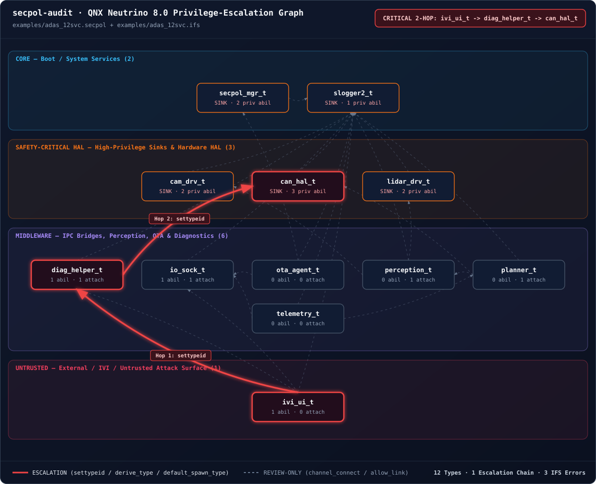

# `secpol-audit` — QNX Neutrino 8.0 Security Policy Auditor & Privilege-Escalation Graph Analyzer

[](https://github.com/anshika-lamba/secpol-audit/actions/workflows/ci.yml)

> **QNX Global Hackathon 2026** — *Developer Tooling & Host Tools* + *Best Use of QNX-Specific Technologies*

`secpol-audit` is a **100% deterministic, fail-closed, zero-dependency** static & runtime security policy auditor and BloodHound-style `settypeid` privilege-escalation graph analyzer for **QNX Neutrino 8.0** (`.secpol` + `build.ifs` + `pidin -f a_n`).



*Generated directly from `examples/adas_12svc.secpol` + `examples/adas_12svc.ifs` via `secpol-audit paths ... --svg docs/adas_graph_preview.svg`. Solid crimson arrows denote real `ESCALATION` transitions (`settypeid`); dashed slate arrows denote `REVIEW-ONLY` IPC edges (`channel_connect` / `allow_link`).*

---

## Screen-1: Predicted vs. Observed Verification Matrix (`5/5 MATCH` on Real QNX 8.0 QEMU)

`secpol-audit` catches transitive multi-hop `settypeid` privilege escalations and `build.ifs` wiring flaws **before flashing a single QNX image**—and has been verified **5/5 MATCH** against real QNX Neutrino 8.0 x86_64 QEMU TCG kernel captures committed in [`evidence/qemu_logs/`](evidence/qemu_logs/).

| Mutant | Policy / IFS Flaw | `secpol-audit` Static Prediction | Real Observed QNX 8.0 QEMU x86_64 TCG Behavior | Evidence Log | Status |
| :--- | :--- | :--- | :--- | :--- | :--- |
| **`M0_clean`** | Hardened baseline | **PASS** (0 chains, 0 wiring errors) | `DIRECT_RESULT=DENIED errno=1`, `HOP1_SPAWN=DENIED errno=1`, `4098 can_hal_t proc/boot/can_server` | [`M0_clean.log`](evidence/qemu_logs/M0_clean.log) | **MATCH** |
| **`M1_no_connect`** | `ivi_ui_t -> diag_helper_t` only (no hop-2 escalation or CAN connect) | **PASS** (0 escalation chains; `diag_helper_t` is not a sink) | `DIRECT_RESULT=DENIED errno=1`, `HOP1_SPAWN=OK child_pid=16388`, `HOP2_SPAWN=DENIED errno=1` | [`M1_no_connect.log`](evidence/qemu_logs/M1_no_connect.log) | **MATCH** |
| **`M2_untyped_server`** | `can_server` launched without `on -T can_hal_t` | **FAIL**: `UNTYPED_IFS_SERVICE` (`HIGH`) | `pidin -f a_n`: `4098 - proc/boot/can_server` -> `RUNTIME_UNTYPED_PROCESS` (`CRITICAL`) | [`M2_untyped_server.log`](evidence/qemu_logs/M2_untyped_server.log) | **MATCH** |
| **`M3_2hop_escalate`** | `ivi_ui_t -> diag_helper_t -> can_hal_t` (`mem_phys`, `io`, `/dev/name/local/can_ctrl`) | **FAIL**: `ESCALATION_CHAIN` (`CRITICAL`, 2-hop) | `DIRECT_RESULT=DENIED errno=1`, `HOP1_SPAWN=OK child_pid=16388`, `HOP2_SPAWN=OK child_pid=16389`, **`HOP2_RESULT=GRANTED coid=1073741825`** | [`M3_2hop_escalate.log`](evidence/qemu_logs/M3_2hop_escalate.log) | **MATCH** |
| **`M3_fixed`** | Removes `settypeid` chain from M3 | **PASS** (`diff`: `-1 escalation chain (0 remaining)`) | `DIRECT_RESULT=DENIED errno=1`, `HOP1_SPAWN=DENIED errno=1`, `4098 can_hal_t proc/boot/can_server` | [`M3_fixed.log`](evidence/qemu_logs/M3_fixed.log) | **MATCH** |

### Offline Replay Verification (`make verify-offline`)

Replaying the 5 real QNX 8.0 QEMU logs in `evidence/qemu_logs/` against `secpol-audit` static predictions:

```text
Log directory: evidence/qemu_logs
------------------------------------------------------------------------------------------------------------
Mutant               | Static Prediction (secpol-audit)           | Observed Log                 | Status
------------------------------------------------------------------------------------------------------------
M0_clean             | PASS (0 chains, 0 wiring errors)           | direct=DENIED, hop1=DENIED   | MATCH
M1_no_connect        | PASS (0 chains, 0 wiring errors)           | direct=DENIED, hop1=OK, hop2_spawn=DENIED | MATCH
M2_untyped_server    | FAIL: UNTYPED_IFS_SERVICE (can_server)     | direct=DENIED, hop1=DENIED, pidin=UNTYPED | MATCH
M3_2hop_escalate     | FAIL: ivi_ui_t -> diag_helper_t -> can_hal_t | direct=DENIED, hop1=OK, hop2=GRANTED | MATCH
M3_fixed             | PASS (0 chains, 0 wiring errors)           | direct=DENIED, hop1=DENIED   | MATCH
------------------------------------------------------------------------------------------------------------
```

> **QEMU TCG & Honesty Disclosure:**
> - All 5 logs in `evidence/qemu_logs/*.log` are real QNX Neutrino 8.0 x86_64 QEMU TCG (`-accel tcg -nographic`) serial captures built with QNX SDP 8.0 (`qcc`, `secpolcompile`, `mkifs`). QEMU software emulation (`-accel tcg`) is used intentionally so live target verification reproduces cleanly on WSL2, CI runners, and laptops without KVM prerequisites.
> - Synthetic unit-test fixtures live separately in `tests/fixtures/sample_qemu_logs/` (`make verify-fixtures`, also `5/5 MATCH`).
> - When `secpolcompile` is absent on a host machine, `secpol-audit` explicitly reports **`skipped`**—never `pass`.

---

## Why `secpolcompile` Alone Is Not Enough (`gain_priv` vs. Transitive Chains)

QNX 8.0's `secpolcompile` enforces **single-hop** privilege-gain declarations via `gain_priv`—it rejects a type transition only if the immediate hop fails to declare the abilities gained across that single edge.

In [`qnx_demo/mutants/M3_2hop_escalate.secpol`](qnx_demo/mutants/M3_2hop_escalate.secpol):
- **Hop 1 (`ivi_ui_t -> diag_helper_t`)** declares `gain_priv:pathspace,settypeid` on `ivi_ui_t`.
- **Hop 2 (`diag_helper_t -> can_hal_t`)** declares `gain_priv:mem_phys,io,channel_connect` on `diag_helper_t`.

Because each individual hop satisfies its local `gain_priv` check, **real QNX 8.0 `secpolcompile` compiles `M3_2hop_escalate.secpol` cleanly with exit code `0`**—even though an untrusted `ivi_ui_t` process still escalates to safety-critical `can_hal_t` (`mem_phys`, `io`, `/dev/name/local/can_ctrl`) in 2 hops on live QNX 8.0 QEMU (`HOP2_RESULT=GRANTED coid=1073741825`).

`secpol-audit` fills this exact blind spot by building the full transitive `settypeid` / `derive_type` / `default_spawn_type` graph across `.secpol` and `build.ifs`, exposing multi-hop escalation chains and gating them in CI before deployment.

---

## Core Design Principles

1. **100% Deterministic & Fail-Closed:** Zero LLM calls in core analysis. Supports QNX 8.0 `.secpol` constructs including `include`, `attribute`, `type`, `range`, custom `ability`, custom `class`, `gain_priv:class:perm:type`, `allow_attach`, `allow_link`, `derive_type`, `default_spawn_type`, and `mount_point`. Any unsupported construct or syntax error emits a structured `UNSUPPORTED_CONSTRUCT` / `PARSE_ERROR` diagnostic with exact `file:line:col` and exits with **code `2`**.
2. **Strict Exit Codes:**
   - `0` — Clean pass (no critical/high/error/medium findings and no privilege expansion)
   - `1` — Policy, IFS wiring, escalation chain, runtime drift finding, or privilege expansion in `diff`
   - `2` — Parser error, `UNSUPPORTED_CONSTRUCT`, unreadable input, or invalid CLI usage
3. **Strict Graph Edge Separation:**
   - **`ESCALATION` (solid crimson):** `settypeid`, `derive_type` (with matching `settypeid`), and `default_spawn_type` transitions.
   - **`REVIEW_ONLY` (dashed slate):** `channel connect` and `allow_link` IPC/namespace edges—explicitly tagged `review-only` and **never** traversed as privilege-escalation hops.
4. **Zero Runtime Dependencies & 100% Offline HTML:** Core `secpol_audit/` uses Python 3.10+ standard library only (`dependencies = []`). Generated `--html` reports are single-file, zero-CDN interactive SVG workbenches.

---

## Quickstart

```bash
# Install editable (Python 3.10+, zero runtime deps)
pip install -e ".[dev]"

# 1. Run static policy + IFS wiring checks with SARIF 2.1.0 output
secpol-audit check examples/adas_12svc.secpol \
  --ifs examples/adas_12svc.ifs \
  --format sarif

# 2. Generate self-contained BloodHound-style HTML workbench (and optional static SVG preview)
secpol-audit paths examples/adas_12svc.secpol \
  --ifs examples/adas_12svc.ifs \
  --html /tmp/adas_report.html \
  --svg docs/adas_graph_preview.svg

# 3. CI privilege-expansion gate (diff vulnerable -> hardened policy)
secpol-audit diff examples/adas_12svc.secpol examples/adas_12svc_fixed.secpol
# -> Escalation chains: -1 escalation chain (0 remaining) (exits 0)

# 4. Verify runtime `pidin -f a_n` snapshot against static policy & IFS
secpol-audit verify-runtime tests/fixtures/sample_qemu_logs/pidin_drift.log \
  --policy examples/adas_12svc_fixed.secpol \
  --ifs examples/adas_12svc_fixed.ifs

# 5. Run the full automated test suite (84 passing tests) & offline log verifiers
make test
make verify-offline
make verify-fixtures
```

---

## 12-Service ADAS Demo (`examples/adas_12svc.*`)

Includes 12 realistic automotive QNX 8.0 services (`slogger2_t`, `secpol_mgr_t`, `io_sock_t`, `can_hal_t`, `lidar_drv_t`, `cam_drv_t`, `perception_t`, `planner_t`, `ota_agent_t`, `diag_helper_t`, `telemetry_t`, `ivi_ui_t`) with 4 planted flaws caught immediately by `secpol-audit`:

1. **`ESCALATION_CHAIN` (CRITICAL):** 2-hop transitive escalation `ivi_ui_t -> diag_helper_t -> can_hal_t` (gains `mem_phys`, `io`, `/dev/can_ctrl`).
2. **`PRE_SECPOLPUSH_LAUNCH` (HIGH):** `telemetry_svc` started before `secpolpush` in `adas_12svc.ifs`.
3. **`UNTYPED_IFS_SERVICE` (HIGH):** `ota_agent` launched after `secpolpush` without `on -T <type>`.
4. **`UNDEFINED_IFS_TYPE` (ERROR):** Typo `on -T diag_hlpr_t diag_helper` (undeclared in `.secpol`).

All 4 flaws are cleanly resolved in `examples/adas_12svc_fixed.secpol` + `examples/adas_12svc_fixed.ifs` (exit `0`, 0 findings).

---

## Live QNX 8.0 C Demo & QEMU Harness (`qnx_demo/`, `harness/`)

To rebuild and re-run all 5 mutants on a host with QNX SDP 8.0 (`qcc`, `secpolcompile`, `mkifs`) and `qemu-system-x86_64`:

```bash
source ~/qnx800/qnxsdp-env.sh
make qemu-mutants
```

- `qnx_demo/can_server.c`: `on -T can_hal_t` resource manager calling `name_attach(NULL, "can_ctrl", 0)` (`/dev/name/local/can_ctrl`) and replying `"CAN_CTRL_GRANTED"`.
- `qnx_demo/diag_helper.c`: spawns probe under `can_hal_t` via `secpol_posix_spawnattr_settypeid(..., "can_hal_t", SECPOL_TYPE_NAME)` and opens `/dev/name/local/can_ctrl` (`HOP2_RESULT=GRANTED coid=...`).
- `qnx_demo/ivi_exploit.c`: proves direct `name_open("can_ctrl", 0)` is denied (`errno=1`), then executes Hop 1 via `secpol_posix_spawnattr_settypeid(..., "diag_helper_t", SECPOL_TYPE_NAME)` + `posix_spawn("/proc/boot/diag_helper")`.
- `harness/observe.py` & `harness/verify_offline.py`: parse real QNX 8.0 serial captures in `evidence/qemu_logs/` and verify `5/5 MATCH` against `secpol-audit` static predictions.
